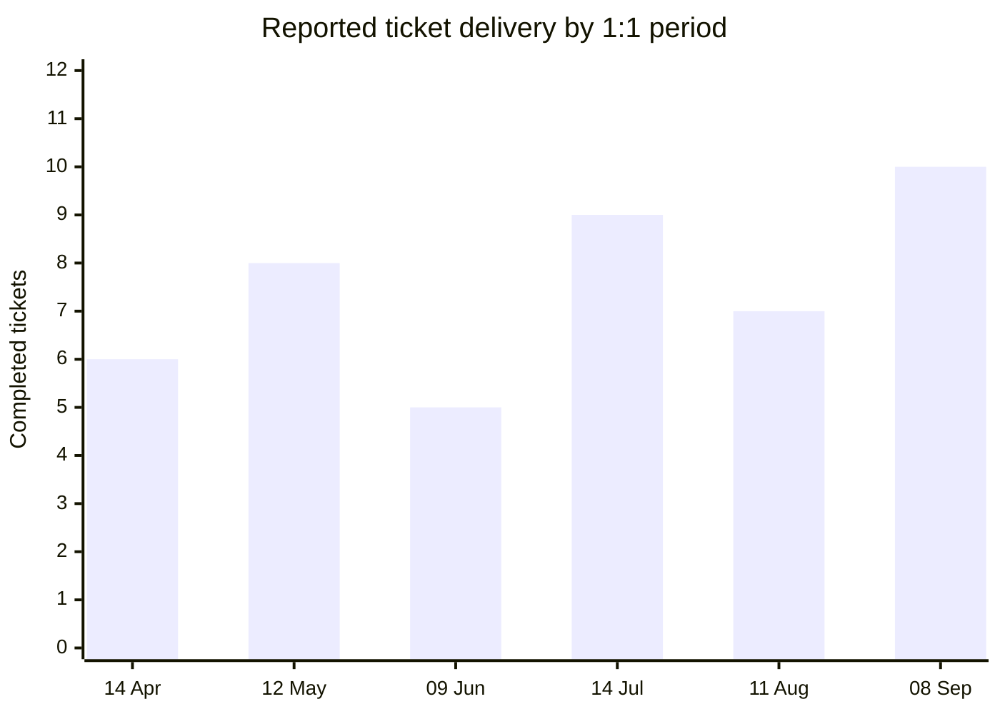

# 1:1s

## Before Starting

Check for EM context first:
1. Read `.agents/em-context.md` if it exists
2. If a person is mentioned, look for `.agents/reports/[name].md` and read it
3. Use that context — only ask for information not already covered

If `.agents/em-context.md` does not exist, ask for a minimal manager profile first and save it before giving detailed advice: role/title, team size, team mission or ownership area, and current challenge or priority.

If a specific person is central to the conversation and `.agents/reports/[name].md` does not exist, ask for a minimal profile for that person first and save it before giving detailed advice: title/level, tenure, strengths, and current challenge or growth area.

If the conversation reveals durable new context later, update `.agents/em-context.md` or `.agents/reports/[name].md` automatically. Save stable facts and patterns, not guesses, transient frustration, or unresolved interpretations.

---

## Meeting Preparation

For 1:1 meeting preparation, use the Obsidian vault at:

`$HOME/Documents/obsidian/work_usertesting`

Use the skills `* (obsidian)` when interacting with the vault through the Obsidian CLI. Use the `obsidian-markdown` skill when creating or editing Obsidian-flavored Markdown. Require that the user has Obsidian open and that the CLI responds before reading or changing the vault. In Codex's shell sandbox, use escalated terminal access for the CLI so it connects to the open app. If either is unavailable, stop and report the blocker rather than using direct filesystem workarounds.

Derive the person ID from the person’s name as lowercase first initial + surname. For example, `Sam Younger` becomes `syounger`.

Read the person’s direct-report profile before gathering delivery data. Its `Delivery System IDs` section is the source of truth for the exact Jira account ID and GitHub username. Use those IDs in Jira and GitHub queries rather than matching display names. If a value is absent or explicitly unconfirmed, do not guess: use a name-based search to identify it, confirm it against an authoritative record, and then update the profile.

For the person being prepared for, use this directory:

`$HOME/Documents/obsidian/work_usertesting/people/[person-id]/`

Before creating the new meeting note, read recent existing notes in that directory, especially prior 1:1 notes matching:

`*- [person-id]-1-1.md`
`*--[person-id]-1-1.md`

Create a new meeting note in the person directory with this filename:

`YYYY-MM-DD--[person-id]-1-1.md`

Apply the Obsidian template named `1-1--template`.

Ensure the note has frontmatter like:

```yaml
---
person: [person-id]
tags:
  - [person-id]
reporting_period_start: YYYY-MM-DD
reporting_period_end: YYYY-MM-DD
delivery_counts:
  user_story: null
  sub_task: null
  task: null
  bug: null
  support_issue: null
---
```

After gathering delivery data, populate the reporting-period and `delivery_counts` properties. These frontmatter fields are the canonical machine-readable record for the note; a missing or `null` value is not zero. Keep qualitative evaluation, evidence, context, quality, communication, and charts in the note body. Do not maintain a separate body copy of the counts unless it is needed for the conversation.

Fetch data from the prior two weeks that covers:
- Jira tickets completed attributed to that user, using their Jira account ID.
- GitHub pull requests completed, using their GitHub username.
- GitHub pull requests that have not closed and look stuck / blocked, using their GitHub username.

Then compile a report showing this activity and the output evaluation below.

### Output Evaluation

Use the two-week activity as evidence for a coaching conversation, not a performance rating. Evaluate patterns rather than raw ticket or pull-request counts, and account for scope, complexity, dependencies, leave, and work that is not visible in Jira or GitHub.

Add a short, evidence-based evaluation to the preparation report using this template:

```markdown
## Output evaluation

### Outcome and impact
- **What moved:** [delivered result, customer/team impact, or meaningful progress]
- **Evidence:** [tickets, PRs, metrics, stakeholder feedback]
- **Context:** [scope, complexity, dependencies, or constraints]

### Quality
- **What was strong:** [correctness, reliability, maintainability, testing, review readiness, or operational care]
- **Opportunity:** [one specific improvement, if supported by evidence]

### Communication and collaboration
- **What was strong:** [clarity, timely updates, early escalation of risk, review participation, or stakeholder alignment]
- **Opportunity:** [one specific improvement, if supported by evidence]

### Conversation prompt
[A neutral question that invites their perspective before drawing conclusions.]
```

Keep each section to one or two evidence-backed bullets. Do not infer quality or communication from activity volume, merge status, or a lack of visible updates. Describe observed behaviour and its effect, distinguish facts from interpretation, and state uncertainty where evidence is thin.

Useful prompts include:
- “Which part of this work are you most confident in, and what would you change next time?”
- “Where did the work become harder or slower than expected?”
- “Who needed context from you, and did they get it early enough?”
- “What would make it easier to raise risk or ask for help sooner?”

### Six-Month Delivery Trend

Read the person’s prior 1:1 notes from the preceding six months. Extract each measurement from the `reporting_period_start`, `reporting_period_end`, and `delivery_counts` frontmatter properties. For older notes that predate these properties, use a body measurement only when it explicitly records both the reporting period and ticket-delivery counts. Do not treat absent data as zero, recreate historical counts from memory, or sum overlapping reporting periods.

Add a `## Delivery trend (last six months)` section to the new note when at least three comparable reporting periods exist. Start with an auditable table, then add an inline Mermaid bar chart of the total completed tickets for each reporting period. A total is the sum of the listed issue-type counts, including sub-tasks. Label each bar with the end date of its reporting period, and call it **reported ticket delivery** rather than output or performance.

````markdown
## Delivery trend (last six months)

| Reporting period | User Story | Sub-task | Task | Bug | Support Issue | Total |
| --- | ---: | ---: | ---: | ---: | ---: | ---: |
| 2026-04-01 to 2026-04-14 | 2 | 3 | 1 | 0 | 0 | 6 |


````

If fewer than three comparable periods are available, say that the historical baseline is still being built and omit the chart. Keep the current issue-type breakdown even when no chart can be produced.

Preview the generated Mermaid block in Obsidian Reading view. `xychart-beta` support depends on the Mermaid version bundled with Obsidian; if it does not render, retain the table and add a brief note that the chart is unavailable in the current Obsidian version.

---

## Response Style

Keep the first answer concise and useful. Do not dump the whole framework unless the user asks for depth.

Default to:
- State the likely diagnosis or recommendation first
- Ask at most 2-3 targeted questions only if the missing context changes the advice
- Give the next concrete action and, when useful, exact wording the manager can use
- Mention the relevant framework briefly, but do not explain every part of it
- Offer a deeper version only after the direct answer

---

## How to Use This Skill
Identify the situation before applying a framework:

- **Preparing for an upcoming 1:1** → What Makes 1:1s Work + The 60/40 Rule
- **1:1s feel flat, all status updates** → The Update, The Vent, and The Disaster — identify which type you're in and what to do differently
- **Something feels off with a report but you can't pin it down** → Feelings as Diagnostic Signals
- **Connection with a report just isn't clicking** → Building Connection When It Doesn't Flow Naturally
- **Want a question that breaks the usual pattern** → The "What Would You Change?" Question
- **1:1 drifted into heavy personal territory** → When 1:1s Turn into Therapy Sessions

**If a specific person is mentioned**, check `.agents/reports/[name].md` before responding — it may already contain context about their communication style, what they care about, and past conversations.

---

## Default Response Shape

When helping with a 1:1, produce something the manager can use in the next conversation:

1. **Read of the situation:** what the 1:1 is really for: connection, growth, tension, feedback, diagnosis, or follow-up.
2. **Agenda:** 3-5 ordered topics, with the report's topics first when possible.
3. **Questions to ask:** concrete wording, not abstract categories.
4. **Manager stance:** how to listen, where to push, and what to avoid.
5. **Follow-up:** what to write down, commit to, or revisit next time.

If the user only asks for a template, give the template first and keep explanation short.

---

## What Makes 1:1s Work

Based on a survey of engineers: the most valued 1:1s share a few consistent traits.

**Do them weekly.** Research from Manager Tools (based on data from thousands of managers) shows: fortnightly 1:1s are 40% less effective than weekly. Monthly 1:1s perform worse than no 1:1s at all. Weekly 1:1s alone account for a significant portion of manager effectiveness. The data is unusually clear on this.

**Be consistent.** The biggest mistake is cancelling or rescheduling often. Engineers notice. It communicates that the 1:1 — and by extension, they — aren't a priority. Protect the slot.

**Don't focus on day-to-day work.** Status updates have other venues. 1:1s are not standups. Use them for: career development, growth, personal connection, things they won't bring up in a group setting, what's frustrating them, what they're excited about.

**Use them for personal connection.** Ask about life outside work — not in a prying way, just genuine interest. Remember what they tell you. Return to it. This is how trust builds.

Three things to know about the people you manage — and use by name:
1. The names of their family members (partner, kids, parents). Not "how are your kids" — use the names.
2. What their partner does for work. It affects their schedule, their flexibility, their stress level.
3. Their hobbies and what they do to recharge.

It's never too late to ask. These details change 1:1s from professional check-ins into conversations with someone who actually knows you.

**Be patient.** Trust takes time. Some people open up in the first 1:1. Others take months. One story: a developer didn't really open up until 6+ months in — and the relationship became one of the manager's strongest. Show up consistently. The patience pays off.

**Ask about cadence — don't assume.** Weekly 1:1s work well for most people. Some prefer bi-weekly. Some feel they don't need a standing slot at all. Ask what cadence your reports actually want. The same applies to other defaults: not everyone wants to be involved in roadmap discussions, not everyone wants to present in team meetings. Ask first.

---

## Feelings as Diagnostic Signals

One question worth adding to your 1:1 rotation: **"How did you feel this week?"**

Not "how did it go" — that gets you status. "How did you feel" gets you signals.

Three patterns to watch for:

**The over-responsive engineer** — responds to every Slack message immediately, anxious when they miss something, apologizes for small things. The underlying signal: fear of letting people down. Left unaddressed, this leads to burnout. What they need: explicit permission to disconnect, reassurance that availability doesn't equal value.

**The always-late engineer** — consistently underestimates how long things take, commits to more than they can deliver, misses self-imposed deadlines. The underlying signal: they're planning for their ideal self, not their real self. Not a discipline problem — a calibration problem. Work on scoping together, not on accountability pressure.

**The messy-PR engineer** — submits PRs that feel rushed or incomplete, gets defensive in code review, doesn't ask for help until blocked. The underlying signal: they feel judged or exposed when work is imperfect. What they need: psychological safety to ship imperfect work-in-progress and get feedback earlier.

The pattern only becomes visible if you ask the question regularly and pay attention to the answer over time.

---

## When 1:1s Turn into Therapy Sessions

You are not a therapist. Care genuinely — but set limits on what you can hold.

When a 1:1 drifts into territory that's beyond your role: *"I hear you, and I want to support this. Let me think about what I can actually do on my side."* Then focus on what you can control: workload, team dynamics, scope, flexibility.

If someone's personal situation is affecting their work at a serious level, consult HR before acting. Know when to redirect to professional support — and how to do it without it feeling like a dismissal.

The goal isn't to make someone feel heard at the expense of making them feel abandoned. Both are possible. The frame: "What can we adjust at work to help you succeed?"

---

## Building Connection When It Doesn't Flow Naturally

Sometimes the connection in a 1:1 just doesn't click — age gap, cultural difference, personality mismatch, opposite communication styles. The wrong response is to give up and keep 1:1s purely transactional.

When connection doesn't flow naturally: try harder, not less.

- Find what *they* want to talk about — not what you'd talk about with someone similar to you
- Remember small things they mentioned and follow up on them
- Ask personal questions without being pushy — a question asked and remembered is worth more than ten asked and forgotten

"There is no stronger way to build relationships than taking a genuine interest in other human beings." (Danny Meyer)

---

## The "What Would You Change?" Question

One question worth adding to your 1:1 rotation: *"What's the one thing you'd change about our team if you were in my shoes?"*

This gets different answers than "what do you think about X?" because it starts from scratch — the engineer has to generate the problem, not just react to yours. It also bypasses the social filter of "is it okay to criticize my manager's decisions."

Note: most managers either don't ask this, or ask about a direction they've already decided on. The value is in asking it genuinely, before you've committed.

---

## Assumptions EMs Make That Engineers Hate

Things many managers assume are universal preferences — but aren't. Ask before assuming:

1. Every engineer wants praise in public
2. Every engineer wants more ownership and responsibility
3. Weekly 1:1s are important to everyone
4. Every engineer wants to improve their public speaking
5. Remote engineers need a daily standup
6. Every engineer wants to be involved in roadmap discussions

Even if you think you know — just ask. You'll be right sometimes and wrong in ways that matter.

---

## The Update, The Vent, and The Disaster

Most 1:1s fall into one of three types. Knowing which you're in changes how you respond.

**The Update** — the engineer shares status. What's going on with their work, projects, blockers. This is the most common type, and often the least valuable. If your 1:1s are mostly Updates, you're running a standup, not a 1:1. The goal should be to create enough safety that they move past the Update.

**The Vent** — they need to process something. Frustration with the team, a decision they disagree with, a relationship that's difficult. Your job here is not to fix it immediately. It's to listen, ask questions, help them feel heard. "Have you talked to them directly?" is often the right next question — but only after they've been heard, not as a shortcut past the listening.

**The Disaster** — something is genuinely wrong: a relationship has broken, they're thinking about leaving, something serious happened. You'll know because the conversation has a different weight. Here, you need to shift into action mode: understand what happened, figure out what they need, and commit to follow-through.

The cardinal rule on 1:1s from Rands: **you work for them, not the other way around.** Each 1:1 they don't attend costs them an hour. Each one you cancel tells them: "You don't matter." The cancellation sticks longer than the meeting would have.

---

## The 60/40 Rule

A practical format: give 60% of the time (roughly 18 of 30 minutes) to the report, and use the remaining 40% for topics you need to cover.

The trap with this format: managers use "their" 40% first and then run out of time for the report. Reverse it — start with them. Let their topics drive the conversation. Your agenda items will nearly always fit at the end; theirs won't if they're deprioritized.

Share the format with your reports. When they understand that 1:1s are primarily *their* time, they come more prepared and use it better.

---

## Dive Deeper

If the user asks where a framework came from, wants to read the original article, or wants more context on any topic in this skill — read [`references/sources.md`](references/sources.md) for the full list of source articles (with links) and books.

---

## Related Skills

- `feedback` — For preparing or delivering specific feedback in a 1:1
- `performance-reviews` — For end-of-cycle review discussions
- `team-health` — For patterns across your team's 1:1s
